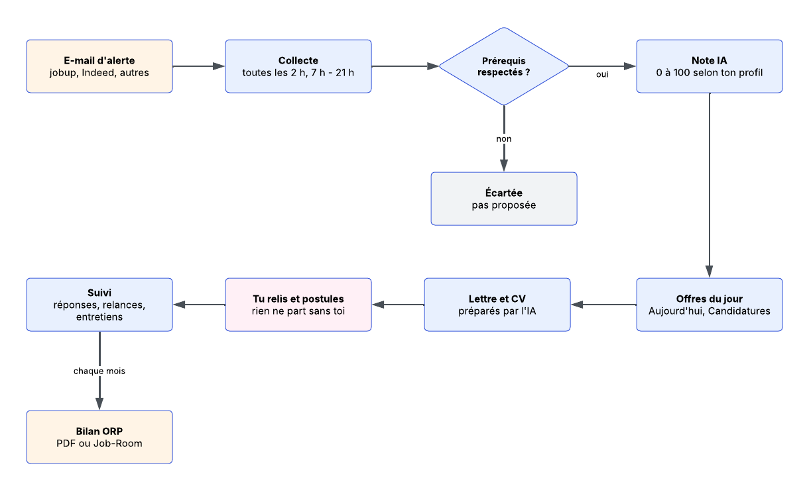
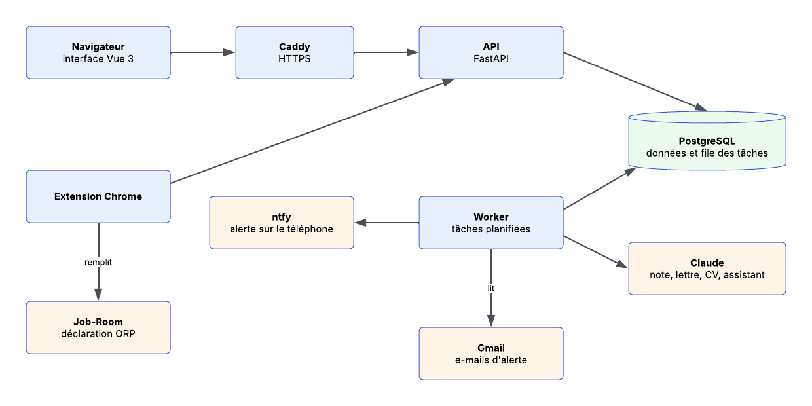
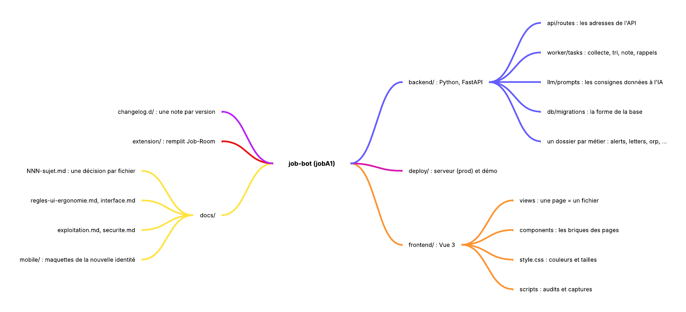

# jobA1

> **Less searching. More living.**

jobA1 lit tes e-mails d'alerte, écarte les offres qui ne respectent pas tes prérequis, note les autres selon ton profil,
prépare lettre et CV, et tient le journal des candidatures pour l'ORP. **Rien ne part sans toi.**

(Nom technique : job-bot. Le paquet, la commande `jobbot` et les variables `JOBBOT_*` gardent ce nom.)

## En 3 schémas

**1. Le trajet d'une offre**



**2. Les pièces de la plateforme**



**3. Où trouver quoi dans le dépôt**



Les schémas sont modifiables dans Lucidchart : [architecture](https://lucid.app/lucidchart/29221eb0-ea5e-4581-bee5-66c1921f1b70/view),
[trajet](https://lucid.app/lucidchart/f32454d7-89db-4b0c-890c-c415d395a2b8/view),
[carte](https://lucid.app/lucidchart/f4cbd5de-fa98-4e08-b631-fff1d4c8ff27/view).

## Lancer en local (macOS)

```bash
brew install uv postgresql@17 && brew services start postgresql@17
make setup     # dépendances, bases, .env
make migrate   # forme de la base
make dev       # API + worker + interface
```

L'interface s'ouvre sur http://localhost:5173 et l'API sur http://127.0.0.1:8000/api/docs. `Ctrl-C` arrête tout.

| Commande | Effet |
|---|---|
| `make demo` | la démo avec des données fictives, sur http://localhost:5200 |
| `make test` | tous les tests |
| `make lint` | ruff, mypy, eslint |
| `make update` | met à jour (git pull, dépendances, migrations) |
| `make openapi` | régénère les types de l'interface depuis l'API |

## Réglages (fichier `.env`, jamais dans git)

| Pour | Réglage |
|---|---|
| Créer le compte ou changer le mot de passe | `cd backend && uv run jobbot set-password` |
| Lire les e-mails d'alerte | `JOBBOT_IMAP_USER`, `JOBBOT_IMAP_PASSWORD`, `JOBBOT_IMAP_FOLDER` |
| L'IA (note, lettre, assistant) | `JOBBOT_ANTHROPIC_API_KEY` |
| Les notifications sur le téléphone | `JOBBOT_NTFY_TOPIC` |

La liste complète se trouve dans [docs/exploitation.md](docs/exploitation.md).

## Pour aller plus loin

Le guide de lecture de la doc se trouve dans [docs/README.md](docs/README.md).

## Données personnelles et licence

Le dépôt est public. CV, profil, offres et lettres restent dans `data/` et dans la base, jamais dans git, et un test le
vérifie. Licence GPL-3.0 ([LICENSE](LICENSE)). Les illustrations sont faites pour jobA1 (docs/67) ; seul le dessin de la page de
maintenance vient d'[unDraw](https://undraw.co).
