# Conformité de l'app à la maquette

Règle de Kevin (18.11.2026) : la maquette est la référence pour **tout** l'affichage. Un écran qui diffère de sa planche est un bug, même sans section du LISEZMOI qui en parle. La table planche → route → composant → état est dans [maquette-map.md](maquette-map.md).

Ce rapport ne corrige rien. Chaque écran est classé :
- **conforme** : rien à reprendre ;
- **écarts mineurs** : style seul (taille, espacement, couleur, icône), la structure est celle de la planche ;
- **à refaire** : la structure diffère (élément manquant, en plus ou à un autre endroit). Une PR « rendre <écran> conforme à <planche> » repartira de la planche.

## Comment les images sont faites

- **Planches** : paquet `jobA1_maquettes_2026-11-18.zip`, ouvertes dans Chromium à la taille de la planche (390 × 844 ou 1440 × 900). Le moteur des planches (`support.js`) n'est pas dans le paquet : la copie gardée dans les fichiers du projet (comparaison du 5.11) a servi, avec le gabarit lu tel qu'écrit. La police manuscrite Caveat Brush n'est pas chargée par les planches : celle de l'app (`frontend/src/assets/fonts/caveat-brush-titres.woff2`) leur est ajoutée, sinon les titres manuscrits s'affichent dans une police à empattements.
- **App** : `main` au commit `9f93964`, démo locale (`jobbot demo-seed`), Playwright à la même taille, en clair et en sombre, animations réduites.
  - Le bandeau « Démo » est masqué : il n'existe pas en production.
  - L'Assistant est déclaré disponible, comme en production. La démo locale n'a pas de clé IA, et sans cela l'onglet Assistant disparaît de la barre du bas.
  - Les états vides (aucune candidature, aucun rendez-vous) sont simulés en vidant les réponses de l'API dans le navigateur. Rien n'est changé dans la base.
- Chaque image montre la planche à gauche et l'app à droite ; en haut le clair, en bas le sombre quand la planche sombre existe. Les images ordinateur sont réduites aux deux tiers.

**Planches défectueuses.** Dix planches ordinateur (Envoyées et Rendez-vous) ont le contenu de leur onglet écrit **hors du cadre** de 900 px, sous la page : `CandidaturesOrdinateurEpinglee`, `CandidaturesOrdinateurStatut`, `EnvoyeesOrdinateurAucuneOuverte`, `EnvoyeesOrdinateurVide`, `RendezVousOrdinateurAucunOuvert`, `RendezVousOrdinateurVide` et leurs versions sombres. Ouvertes telles quelles, elles montrent une page vide sous les onglets. Pour la comparaison, l'en-tête et le contenu ont été remis bout à bout (contenu collé sous les onglets). En sombre, ces planches dessinent en plus un fond **blanc** sous la colonne de droite et un titre presque invisible : c'est la planche qui est fausse, pas l'app. À corriger dans la maquette.

## Écarts communs à toutes les pages téléphone

Ils se voient sur chaque capture de Candidatures et seront traités une seule fois (barre du bas, en-tête) :

1. **Pastille sur le disque Candidatures** de la barre du bas (« 7 ») : aucune planche n'en dessine.
2. **Icône Bilan** : flèche ↗ dans l'app, courbe montante sur les planches.
3. **Encoche de la barre du bas** : sur la planche, le fond de la barre est plein autour du disque actif ; dans l'app, le contenu de la liste se voit à travers l'encoche.
4. **Logo d'initiales** des entreprises : tuile colorée (orange, bleu, noir) dans l'app, tuile beige claire sur les planches.
5. **Pastille de l'onglet Rendez-vous** (orange « 1 ») : absente de l'app alors qu'un rendez-vous ORP passé est dans la démo. À vérifier : la pastille ne compte que les rendez-vous « à noter », et celui de la démo a déjà son compte rendu.

Sur ordinateur : la ligne « 8 offres » au-dessus de la liste n'est sur aucune planche ; les zones de texte de plusieurs lignes (Ajouter, Candidature spontanée) sont deux fois moins hautes que sur la planche.

## Candidatures : bilan

| # | Écran | Planche | Taille | Classement |
|---|---|---|---|---|
| 1 | Offres, liste | Candidatures | 390 | écarts mineurs |
| 2 | Offres, filtres | Filtres | 390 | écarts mineurs |
| 3 | Ajouter une offre | AjouterOffreTel | 390 | conforme |
| 4 | Envoyées, liste | Envoyees | 390 | **à refaire** |
| 5 | Envoyées, filtres | FiltresEnvoyees | 390 | **à refaire** |
| 6 | Envoyées, vide | EnvoyeesVide | 390 | écarts mineurs |
| 7 | Détail d'une candidature | EnvoyeeDetail | 390 | **à refaire** |
| 8 | Détail, Ce que tu as envoyé | EnvoyeeDetailDocuments | 390 | écarts mineurs |
| 9 | Détail, Trouver un contact | EnvoyeeDetailContacts | 390 | écarts mineurs |
| 10 | Détail, J'ai contacté quelqu'un | EnvoyeeDetailContacte | 390 | écarts mineurs (une question) |
| 11 | Rendez-vous, liste | RendezVous | 390 | **à refaire** |
| 12 | Rendez-vous, vide | RendezVousVide | 390 | écarts mineurs |
| 13 | Préparer le rendez-vous | RendezVousPreparer | 390 | écarts mineurs |
| 14 | Offres, une offre ouverte | CandidaturesOrdinateurB | 1440 | écarts mineurs |
| 15 | Offres, aucune ouverte | CandidaturesOrdinateurAucuneOuverte | 1440 | écarts mineurs |
| 16 | Ajouter (panneau) | CandidaturesOrdinateurAjouter | 1440 | écarts mineurs |
| 17 | Candidature spontanée (panneau) | CandidaturesOrdinateurSpontanee | 1440 | écarts mineurs |
| 18 | Envoyées, une candidature ouverte | CandidaturesOrdinateurEpinglee | 1440 | écarts mineurs |
| 19 | Envoyées, aucune ouverte | EnvoyeesOrdinateurAucuneOuverte | 1440 | conforme |
| 20 | Envoyées, vide | EnvoyeesOrdinateurVide | 1440 | conforme |
| 21 | Rendez-vous, aucun ouvert | RendezVousOrdinateurAucunOuvert | 1440 | écarts mineurs |
| 22 | Rendez-vous, vide | RendezVousOrdinateurVide | 1440 | conforme |

Total : 5 conformes, 13 avec écarts mineurs, 4 à refaire.

**Pas comparés, état absent de la démo** (à ajouter à `demo-seed` ou à simuler) : `CandidaturesAgence` (aucune offre d'agence ; la version ordinateur est simulée plus bas, n° 33), `CandidaturesGlisser` (geste en cours), `CandidaturesVide`, `CandidaturesVideAlertes` et leurs versions ordinateur (compte sans offre), `EnvoyeesStatut` et `CandidaturesOrdinateurStatut` (toast après un e-mail reçu), `RendezVousFeuilleV2` et `RendezVousFeuilleOrdinateurV2` (rendez-vous ORP le lendemain ; celui de la démo est dans 6 jours).

**Écran de l'app sans planche** : sur ordinateur, Rendez-vous avec un rendez-vous ouvert (colonne de droite « Voir ma feuille », « Ce que tu apportes », questions). `RendezVousFeuilleOrdinateurV2` est un autre écran : le volet de veille ouvert depuis Aujourd'hui. Il faut la planche avant de toucher cette colonne.

## Téléphone

### 1. Offres, liste · écarts mineurs
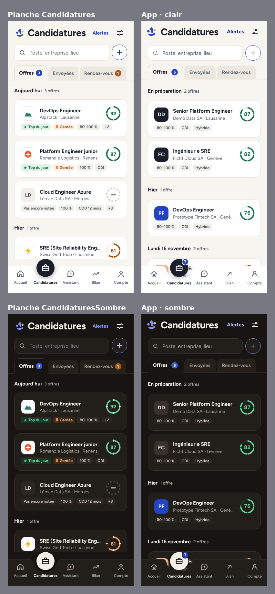
- Les cartes de l'app n'ont pas les pastilles « Top du jour » et « Gardée » de la planche ; la ligne de pastilles ne montre que taux, contrat, télétravail.
- L'app ouvre la liste sur « En préparation » ; la planche commence par « Aujourd'hui ». Le groupe « En préparation » est une fonction de `main` : il reste tant que Kevin ne dit pas de le retirer.
- Plus les écarts communs (pastille du disque, icône Bilan, encoche, logos).

### 2. Offres, filtres · écarts mineurs
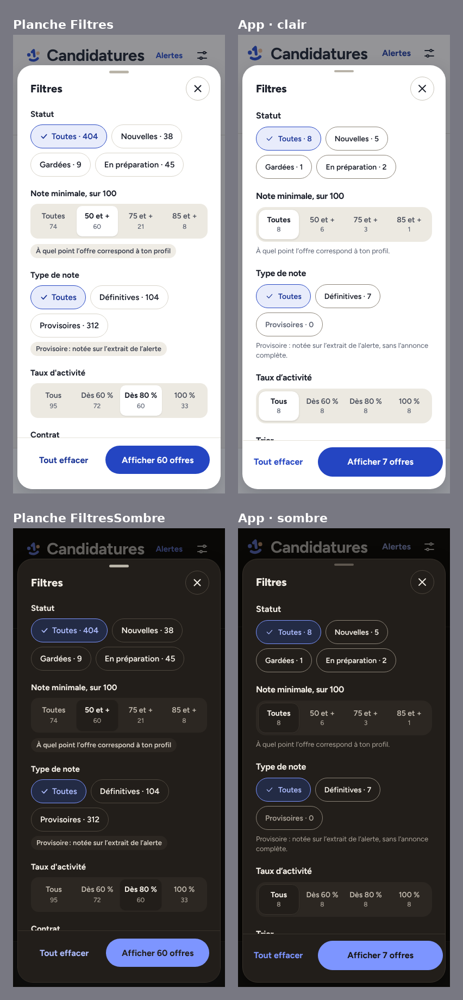
- Les aides sous « Note minimale » et « Type de note » sont une pastille beige sur la planche, un texte gris simple dans l'app.
- Les choix segmentés (Note minimale, Taux d'activité) ont une bordure dans l'app, aucune sur la planche.
- Après « Taux d'activité », la planche montre « Contrat », l'app « Trier » (le filtre Contrat est en cours dans un autre fil).
- Le bouton « Afficher n offres » touche presque le bord droit de la feuille ; la planche garde la marge de 20 px.

### 3. Ajouter une offre · conforme
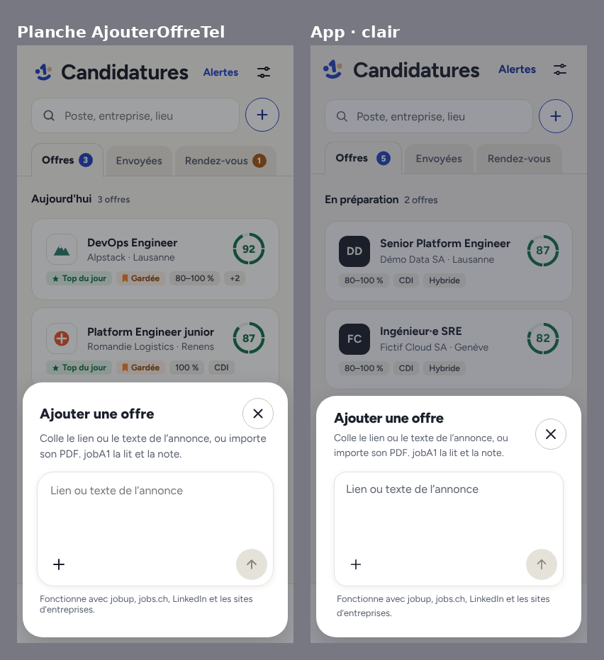

### 4. Envoyées, liste · à refaire
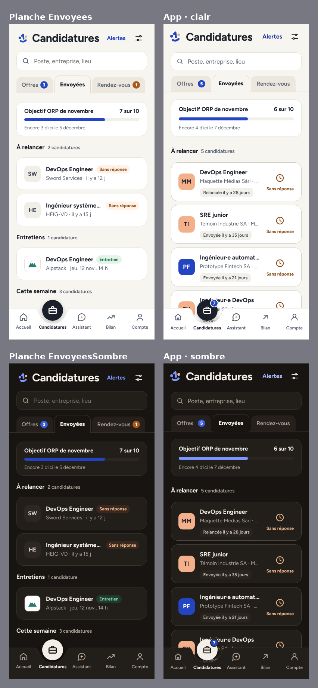
- **Carte** : sur la planche, le statut est une pastille à droite du titre et la ligne 2 dit « entreprise · il y a 12 j » ; la carte fait environ 86 px. Dans l'app, le statut est une icône horloge avec « Sans réponse » dans une colonne à droite, et une pastille grise « Relancée il y a 28 jours » ajoute une troisième ligne (environ 104 px).
- Le fil « Bloquer les bugs d'affichage avant les PR » corrige en ce moment les pastilles d'Envoyées : la PR de cet écran attendra la sienne.

### 5. Envoyées, filtres · à refaire
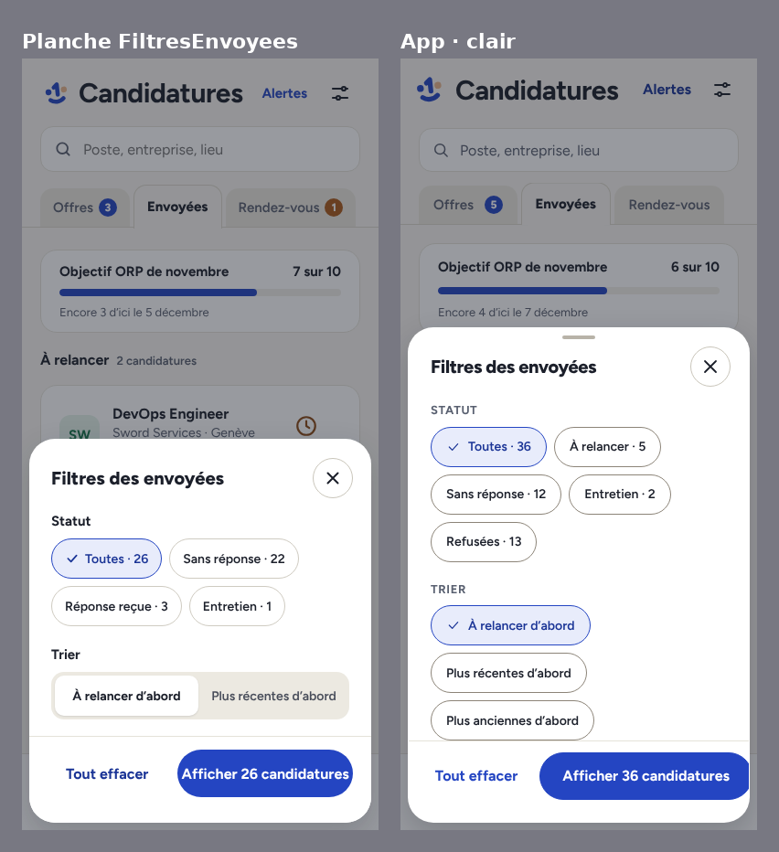
- Titres de section en capitales (« STATUT », « TRIER ») au lieu de « Statut », « Trier ».
- « Trier » : trois pilules sur trois lignes dans l'app, un choix segmenté à deux options sur la planche. « Plus anciennes d'abord » existe dans `main` et pas sur la planche : à garder tant que Kevin ne dit pas de le retirer.
- Statuts : l'app propose « À relancer » et « Refusées », la planche « Réponse reçue ». Les choix viennent des données : question pour Kevin.
- Le bouton « Afficher » dépasse la marge droite.

### 6. Envoyées, vide · écarts mineurs
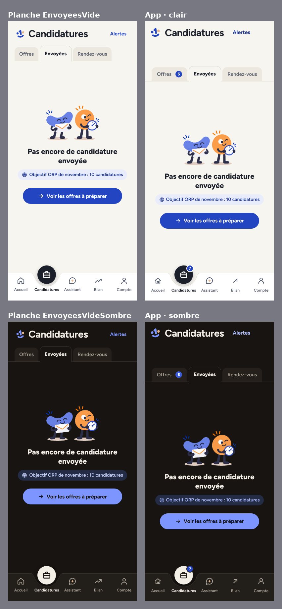
- L'app garde la place de la recherche (masquée) : les onglets et tout le contenu descendent d'environ 60 px.

### 7. Détail d'une candidature · à refaire
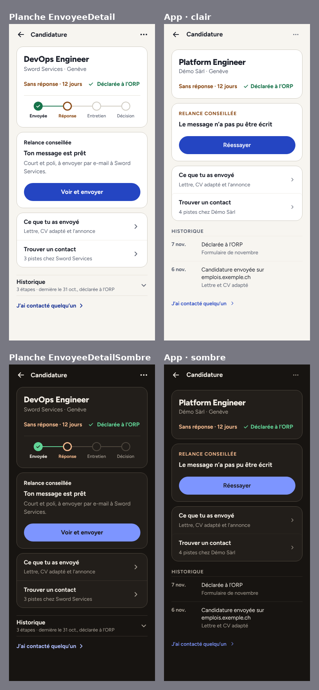
- **Frise des étapes absente** (Envoyée, Réponse, Entretien, Décision) sous le statut.
- « Relance conseillée » : petit titre en casse normale, noir, sur la planche ; en capitales orange dans l'app.
- **Historique** : une ligne repliable sur la planche (« Historique, 3 étapes · dernière le … » avec chevron) ; une liste dépliée à titre en capitales dans l'app.
- Chevrons plus petits et plus pâles que sur la planche.
- « Le message n'a pas pu être écrit » vient de la démo sans clé IA ; la planche montre l'état « Ton message est prêt ».
- Le même fil « Bloquer les bugs d'affichage » travaille sur ce détail : la PR attendra la sienne.

### 8. Détail, Ce que tu as envoyé · écarts mineurs
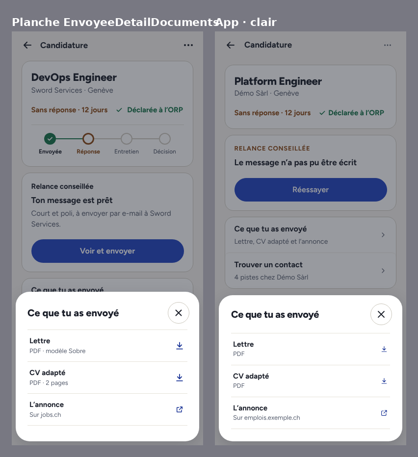
- Icônes de téléchargement plus petites et plus fines.
- Sous « Lettre » et « CV adapté », la planche donne « PDF · modèle Sobre » et « PDF · 2 pages » ; l'app seulement « PDF ».

### 9. Détail, Trouver un contact · écarts mineurs
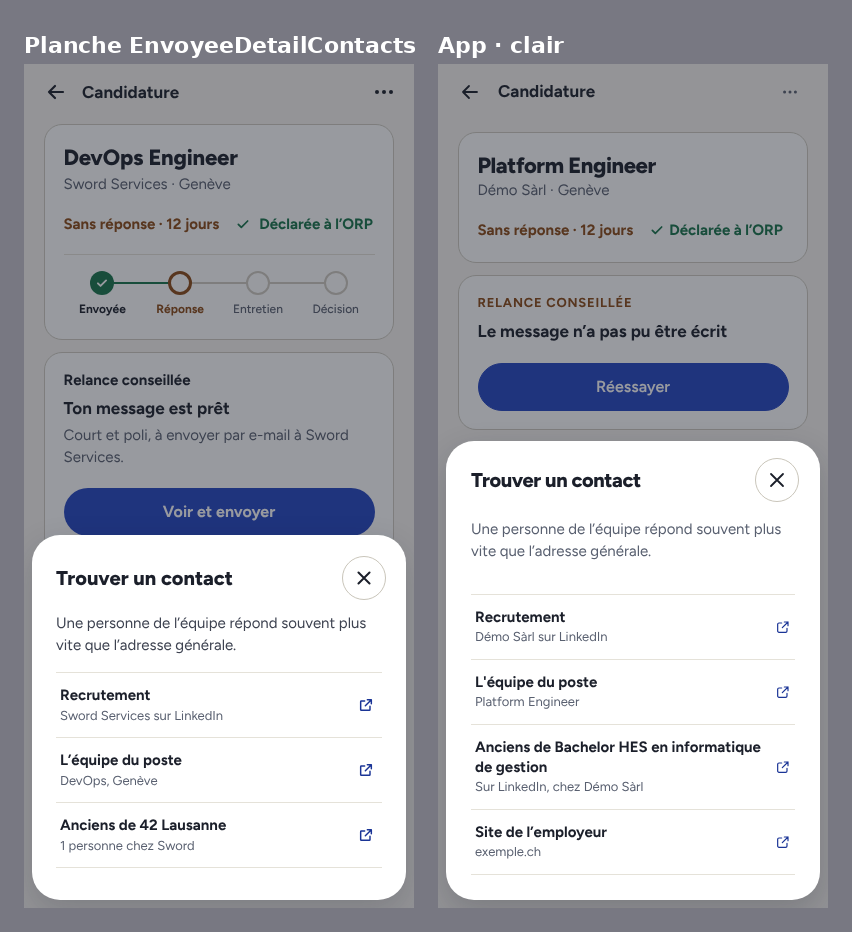
- Plus d'espace entre le titre et le texte d'intro dans l'app ; icônes plus petites.
- L'app ajoute la ligne « Site de l'employeur » : fonction de `main`, gardée.

### 10. Détail, J'ai contacté quelqu'un · écarts mineurs, une question
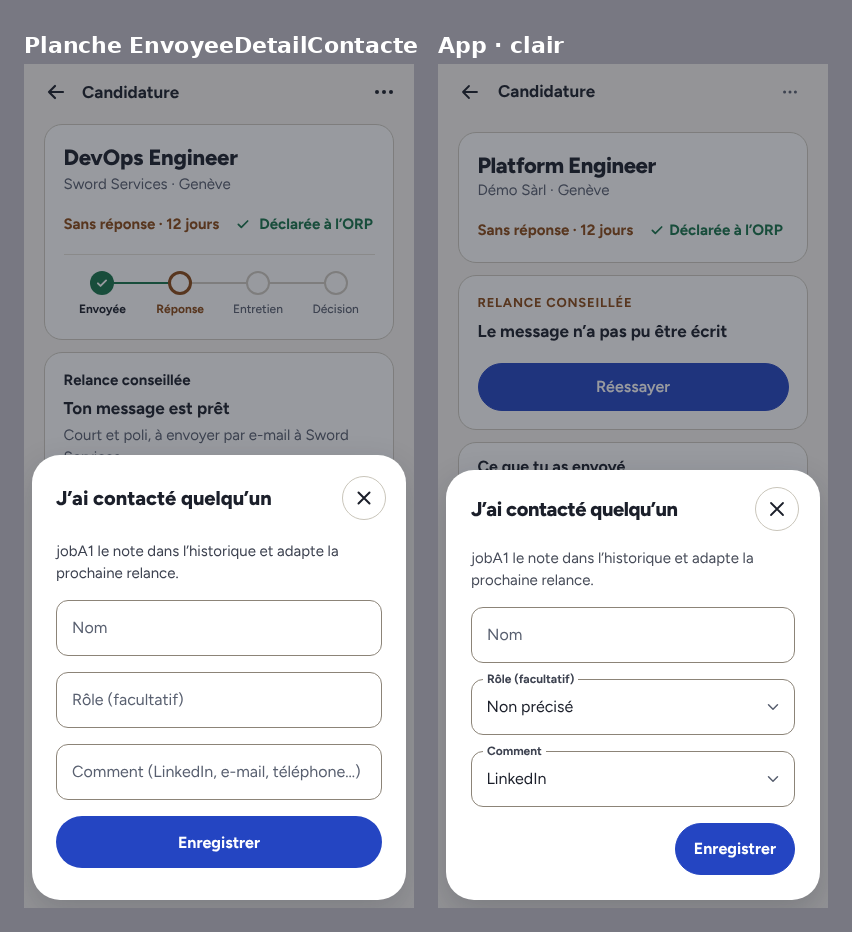
- « Enregistrer » est un bouton pleine largeur sur la planche, un bouton à droite dans l'app.
- Question : « Rôle » et « Comment » sont des champs de texte libres sur la planche, des listes de choix dans l'app. Passer au texte libre changerait les données enregistrées : c'est à Kevin de décider.

### 11. Rendez-vous, liste · à refaire
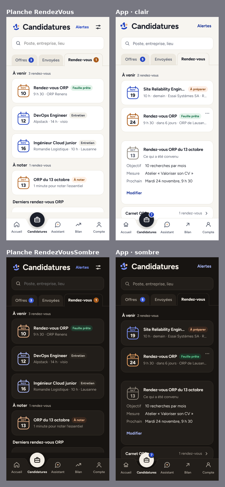
- L'en-tête de l'app n'a pas le bouton de filtres de la planche.
- **« À noter » manque** : la planche a une section « À noter » avec une carte compacte « ORP du 13 octobre · À noter · 1 minute pour noter l'essentiel », puis « Derniers rendez-vous ORP ». L'app montre à la place une grande carte « Rendez-vous ORP du 13 octobre · Ce qui a été convenu » (Objectif, Mesure, Prochain, Modifier) puis une ligne « Carnet ORP ». Aucune planche ne dessine ces deux éléments.
- Menu ⋯ sur la carte « Rendez-vous ORP » : absent de la planche (fonction de `main`, gardée).

### 12. Rendez-vous, vide · écarts mineurs
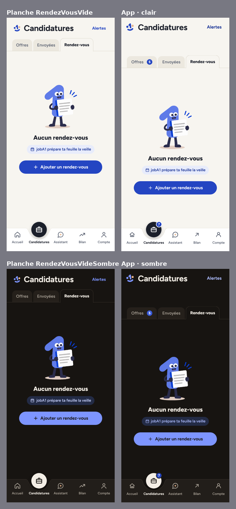
- Même place gardée pour la recherche qu'en 6 : tout descend d'environ 60 px.

### 13. Préparer le rendez-vous · écarts mineurs
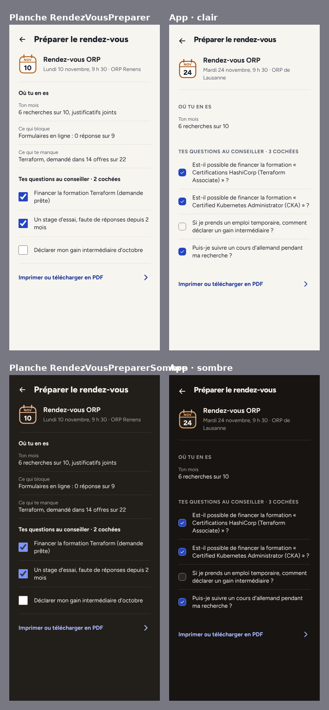
- Titres de section en capitales grises dans l'app, en casse normale noire et grasse sur la planche.
- Cases à cocher de 18 px arrondies et fines dans l'app, 24 px pleines sur la planche.
- « Ce qui bloque » et « Ce qui te manque » n'apparaissent pas : la démo n'a pas ces données (à vérifier avec des données qui les remplissent).

## Ordinateur

### 14. Offres, une offre ouverte · écarts mineurs
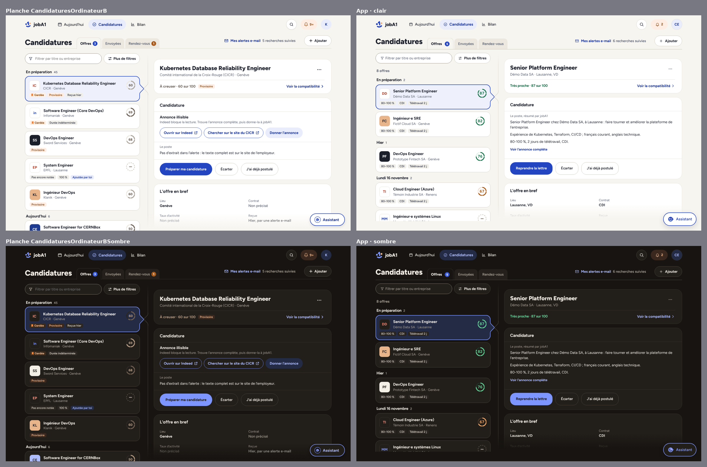
- Ligne « 8 offres » en plus au-dessus de la liste.
- Les cartes n'ont pas les pastilles « Gardée », « Provisoire », « Reçue hier ».

### 15. Offres, aucune ouverte · écarts mineurs
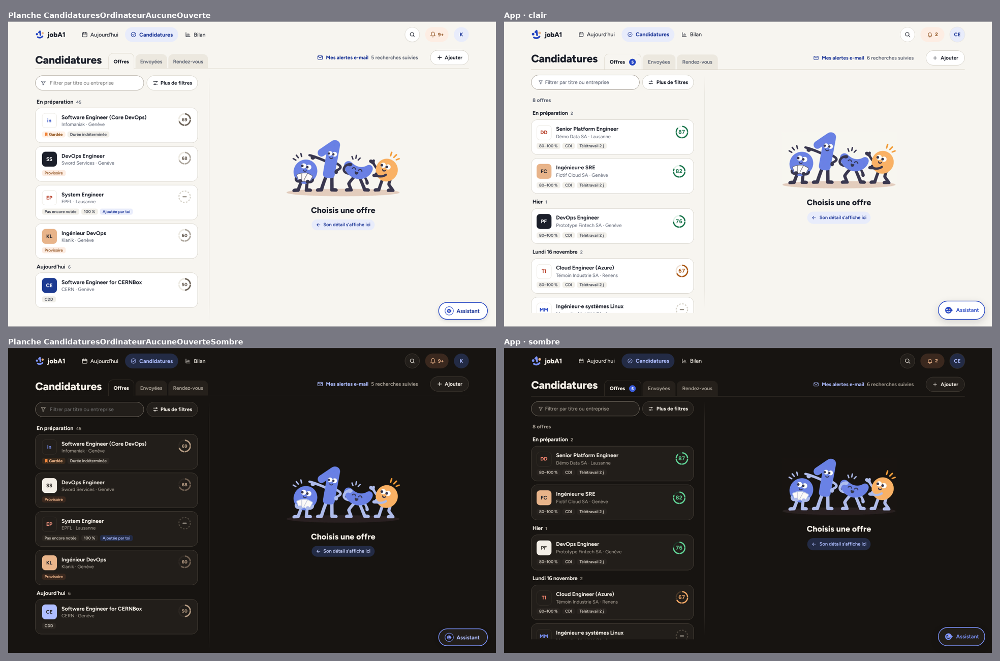
- Ligne « 8 offres » ; l'illustration est un peu plus grande que sur la planche.

### 16. Ajouter (panneau) · écarts mineurs
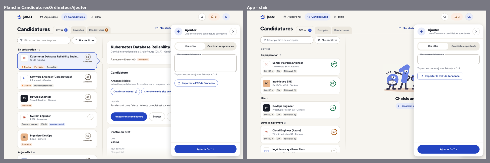
- La zone « Lien ou texte de l'annonce » fait environ 40 px de haut, 70 px sur la planche.

### 17. Candidature spontanée (panneau) · écarts mineurs
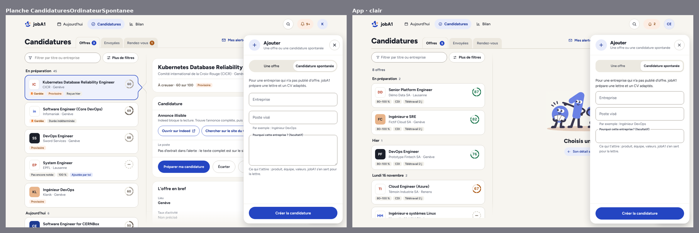
- La zone « Pourquoi cette entreprise ? » fait environ 40 px de haut, 85 px sur la planche.

### 18. Envoyées, une candidature ouverte · écarts mineurs
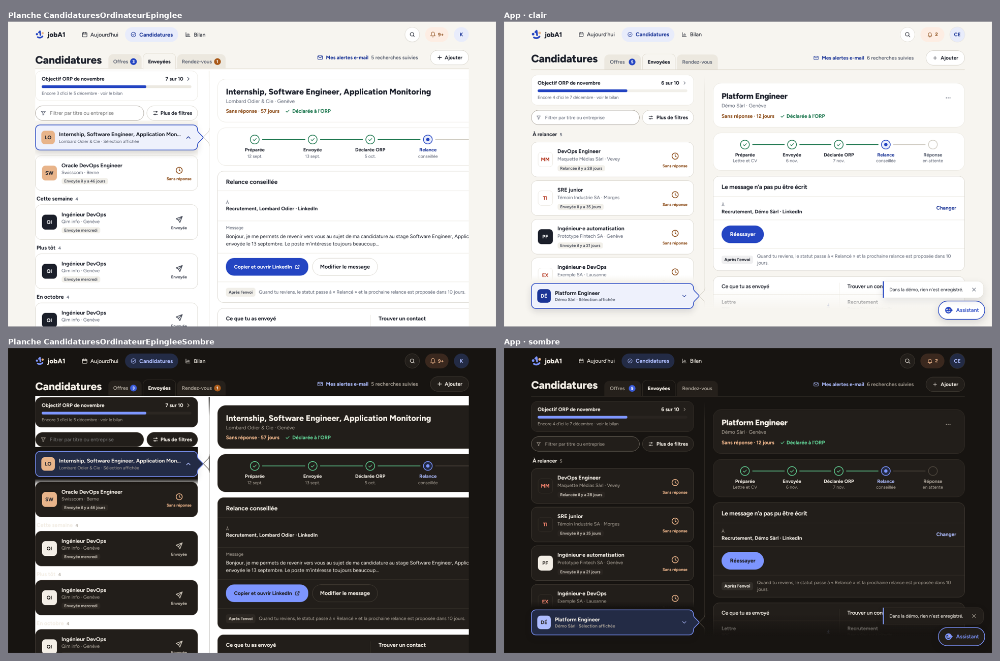
- La carte choisie est épinglée en bas de la liste dans l'app (chevron vers le bas), en haut sur la planche. Dans la démo, la carte est plus bas que la partie visible : épingler en bas suit sans doute la règle. À confirmer par Kevin.
- La frise de l'app a une cinquième étape « Réponse en attente » ; la planche est coupée après « Relance conseillée ».

### 19. Envoyées, aucune ouverte · conforme
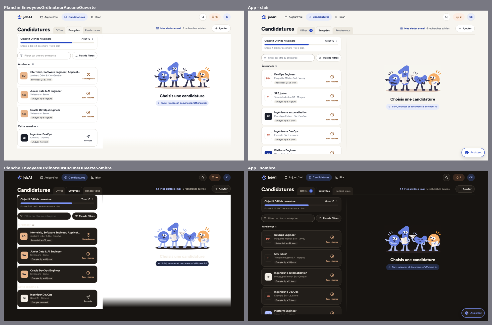

### 20. Envoyées, vide · conforme
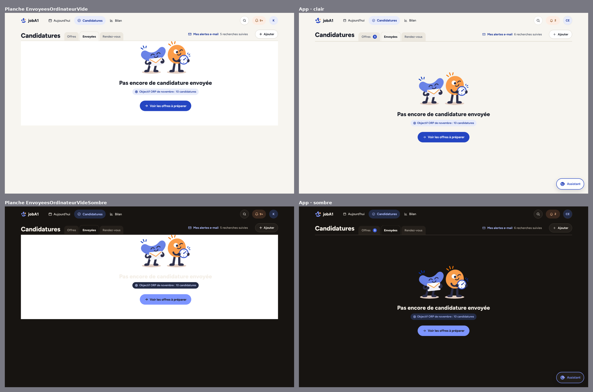
- L'illustration est centrée dans la page ; sur la planche recomposée, elle est en haut. La planche étant hors cadre, sa position n'est pas fiable.

### 21. Rendez-vous, aucun ouvert · écarts mineurs
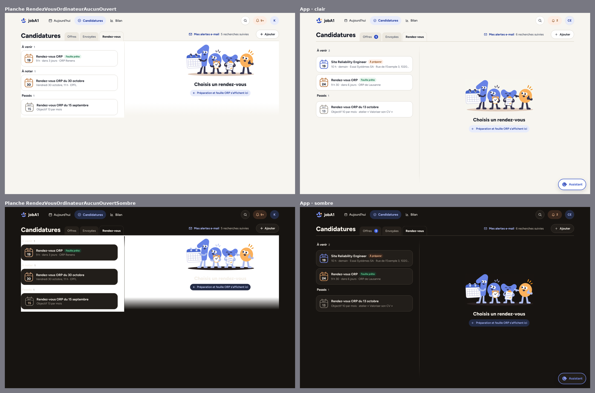
- Pas de section « À noter » (mêmes données qu'en 11).
- Illustration centrée en hauteur ; en haut sur la planche (même réserve qu'en 20).

### 22. Rendez-vous, vide · conforme
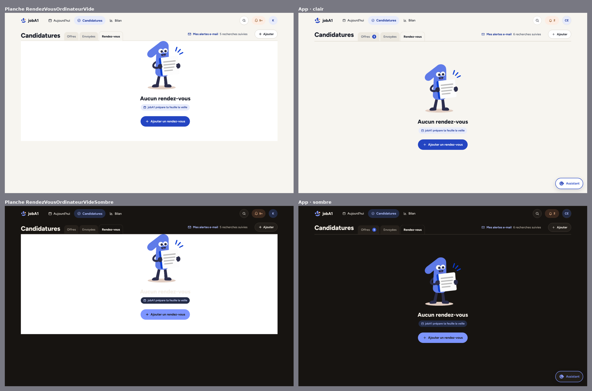

## Fiche d'une offre : bilan

Offre 28 de la démo (Senior Platform Engineer), 34 (écartée), 37 (pas encore notée), 32 (gardée). Les états agence, expirée et adresse trouvée sont simulés en modifiant la réponse de l'API dans le navigateur.

| # | Écran | Planche | Taille | Classement |
|---|---|---|---|---|
| 23 | Fiche d'une offre | Offre | 390 | **à refaire** |
| 24 | Compatibilité | OffreCompatibilite | 390 | écarts mineurs |
| 25 | Offre écartée | OffreEcartee | 390 | écarts mineurs |
| 26 | Offre pas encore notée | OffreNonNotee | 390 | **à refaire** |
| 27 | Offre d'agence | OffreAgence | 390 | écarts mineurs (en-tête commun) |
| 28 | Offre expirée | OffreExpiree | 390 | **à refaire** |
| 29 | Adresse trouvée | OffreAdresseTrouvee | 390 | **à refaire** |
| 30 | Actions d'une offre | ActionsOffre | 390 | écarts mineurs |
| 31 | Actions d'une offre gardée | ActionsOffreGardee | 390 | écarts mineurs |
| 32 | Écartées (ordinateur) | CandidaturesOrdinateurEcartee | 1440 | écarts mineurs |
| 33 | Offre d'agence (ordinateur) | CandidaturesOrdinateurAgence | 1440 | écarts mineurs |

Total : 0 conforme, 7 avec écarts mineurs, 4 à refaire. Les n° 26, 28 et 29 sont en partie traités par la PR en cours sur la fiche d'une offre (lot 3 de l'audit, #863 : K2 « Noter maintenant », K9 offre expirée, K6 adresse) ; à recomparer après sa fusion.

**Pas comparés, état absent de la démo** : `OffreProvisoire` (note provisoire), `OffreAdresseRecherche` et `OffreAdresseNonTrouvee` (recherche d'adresse en cours ou sans résultat).

### 23. Fiche d'une offre · à refaire
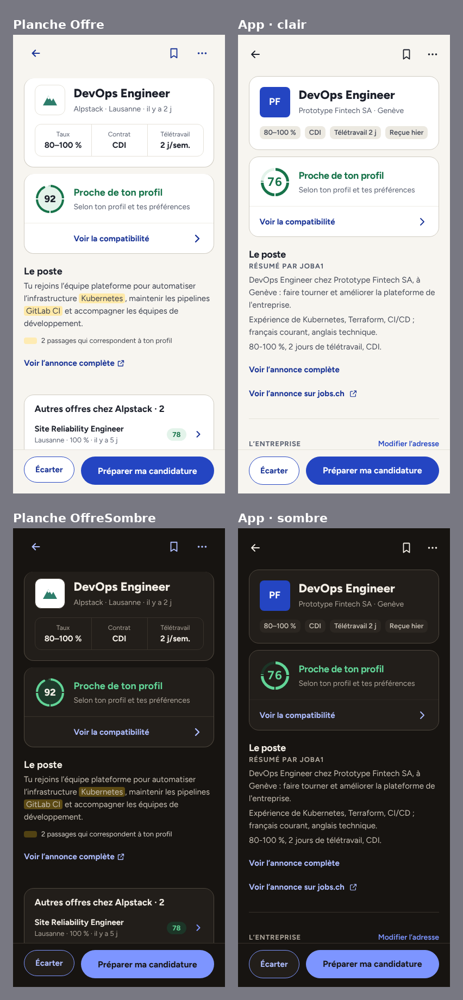
- En-tête : la planche montre une grille Taux · Contrat · Télétravail avec des icônes bleues ; l'app montre des pastilles.
- « Le poste » : la planche surligne des passages de l'annonce ; l'app montre un « RÉSUMÉ PAR JOBA1 » en capitales.
- La carte « Autres offres chez … » de la planche manque.
- « L'ENTREPRISE » en capitales dans l'app (titre en casse normale sur la planche).
- Deux liens vers l'annonce dans l'app, un seul sur la planche.

### 24. Compatibilité · écarts mineurs
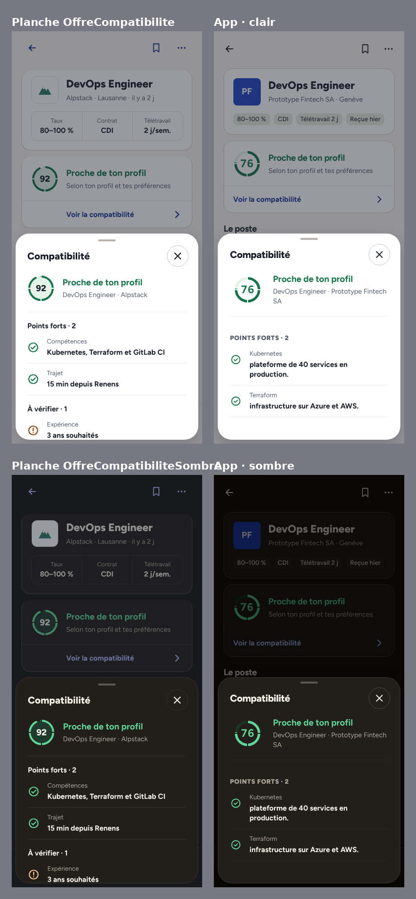
- « POINTS FORTS » en capitales.
- Pas de bloc « À vérifier » : l'offre de la démo n'a pas de point à vérifier (données).

### 25. Offre écartée · écarts mineurs
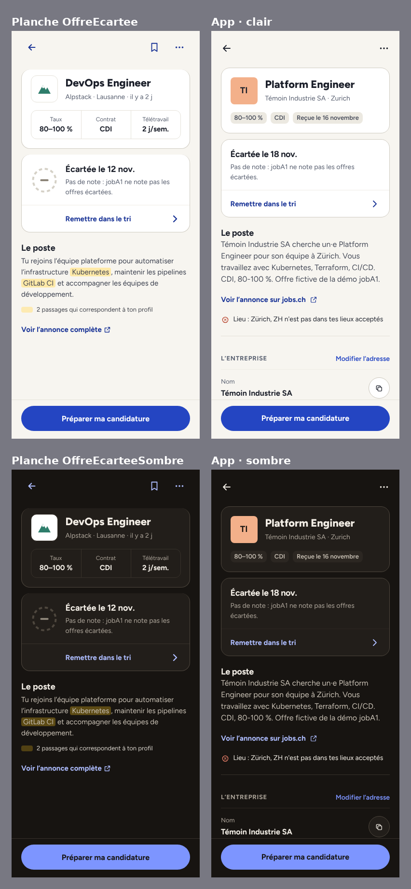
- Pas d'anneau pointillé autour de la note ; pas de signet.
- La raison du filtre qui a écarté l'offre est en plus : fonction de `main`, gardée.
- Plus l'en-tête commun de la fiche (n° 23).

### 26. Offre pas encore notée · à refaire
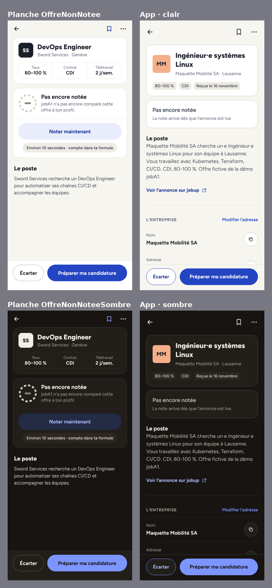
- Pas d'anneau pointillé ; le bouton « Noter maintenant » et sa pastille manquent (K2, PR #863).

### 27. Offre d'agence · écarts mineurs
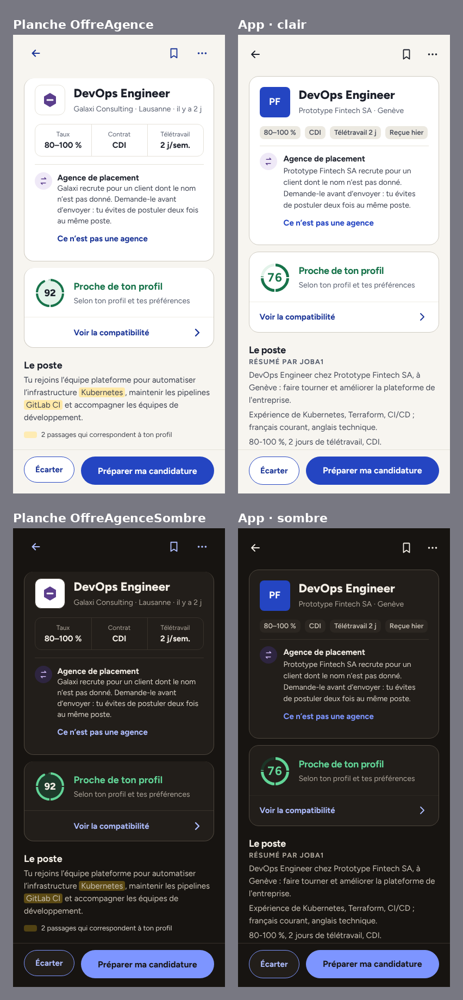
- Le bloc « Agence » est celui de la planche. Restent les écarts de l'en-tête commun (n° 23).

### 28. Offre expirée · à refaire
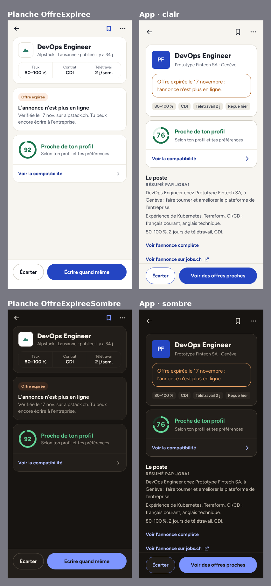
- La planche montre une carte « Offre expirée » avec « Vérifiée le … » et le bouton « Écrire quand même ».
- L'app montre un cadre orange et « Voir des offres proches » (K9, PR #863).

### 29. Adresse trouvée · à refaire
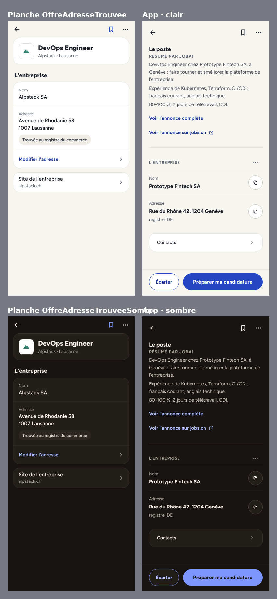
- La planche : carte « L'entreprise », adresse sur deux lignes, pastille « Trouvée au registre du commerce », ligne « Modifier l'adresse », carte « Site de l'entreprise ».
- L'app : titre en capitales, boutons copier, texte « registre IDE », ligne « Contacts » (fonction de `main`, gardée). En partie traité par K6 (PR #863).

### 30. Actions d'une offre · écarts mineurs
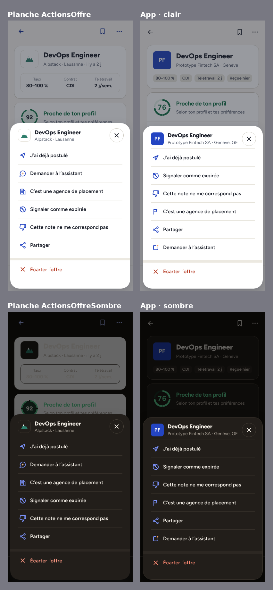
- Ordre des lignes différent de la planche.
- Icônes : agence = immeuble sur la planche, drapeau dans l'app ; Assistant = bulle sur la planche, carré dans l'app.

### 31. Actions d'une offre gardée · écarts mineurs
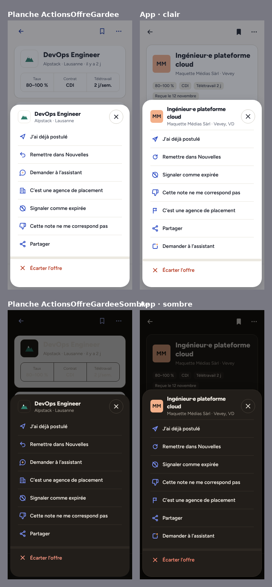
- Mêmes écarts qu'en 30 ; icône de « Remettre » (flèche) différente.

### 32. Écartées (ordinateur) · écarts mineurs
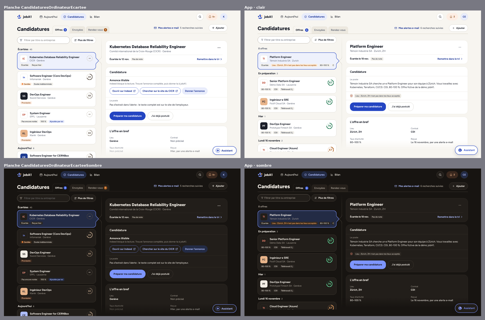
- Titre de section « Écartées 45 » sur la planche, ligne « 8 offres » dans l'app.
- La raison du filtre est une pastille de plus sur la carte (fonction de `main`, gardée).
- « Annonce illisible » de la planche : pas dans les données de la démo.

### 33. Offre d'agence (ordinateur) · écarts mineurs
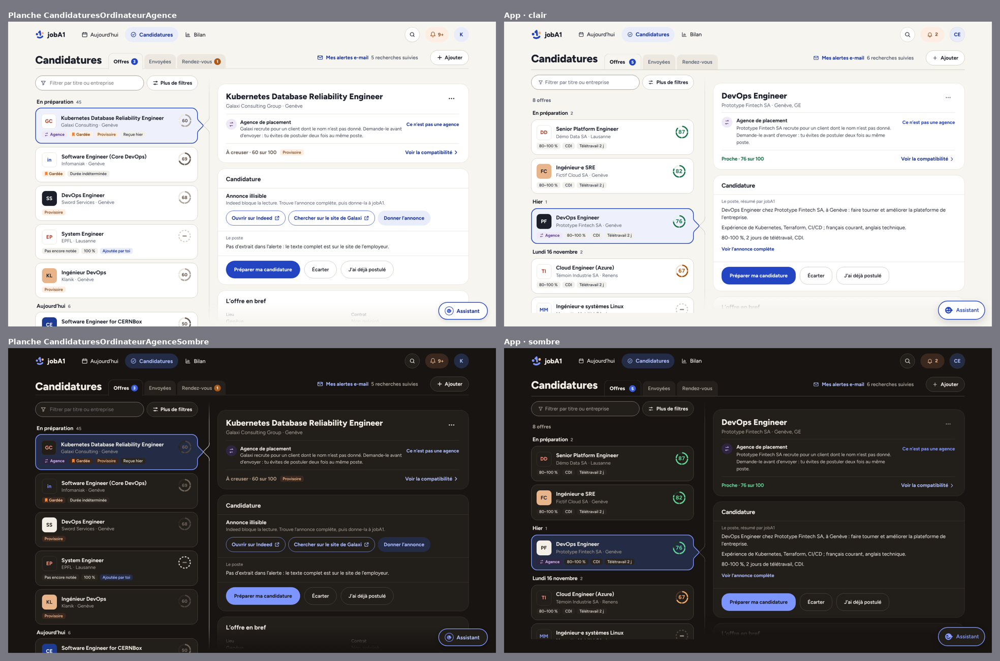
- Le bloc « Agence » est celui de la planche ; la pastille « Agence » est en plus sur la carte de la liste.
- Ligne « 8 offres » (écart commun) ; l'offre choisie est plus bas dans la liste (ordre des données).

## Accueil : bilan

| # | Écran | Planche | Taille | Classement |
|---|---|---|---|---|
| 34 | Accueil | AccueilV2 | 390 | écarts mineurs |
| 35 | Aujourd'hui | AujourdhuiOrdinateurV2 | 1440 | écarts mineurs |

**Pas comparés, état absent de la démo** : `AccueilJustificatif` (justificatifs ORP en retard, avec le bandeau « Exporter »), `AccueilNouveau` et `AccueilPremiereCandidature` (compte neuf) et leurs versions ordinateur.

### 34. Accueil · écarts mineurs
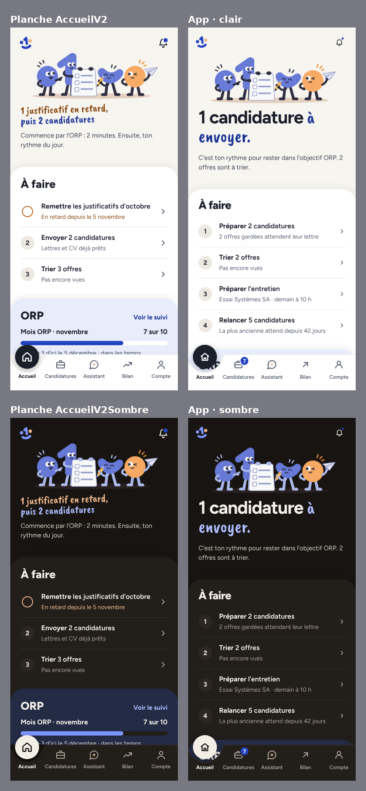
- Titre : la démo n'a pas de justificatif en retard, l'app montre donc « 1 candidature à envoyer. » (Figtree et une partie manuscrite, plus grand). C'est l'écart validé par Kevin le 18.11 (docs/decisions/2026-11-18-0844-accueil-telephone.md), pas un nouvel écart.
- Texte des tâches (« Préparer 2 candidatures », relances dans « À faire ») : écarts gardés par la même décision.
- Plus les écarts communs (pastille du disque, icône Bilan, encoche).

### 35. Aujourd'hui (ordinateur) · écarts mineurs
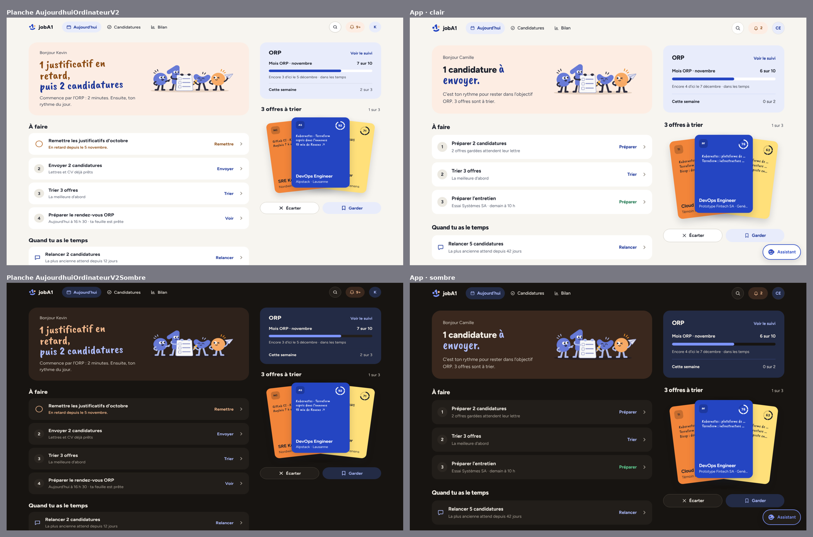
- Titre : toutes les variantes de la planche sont entièrement manuscrites (44 px, deux couleurs, penchées). Le titre d'un jour ordinaire « 1 candidature à envoyer. » (Figtree et manuscrit) n'est dessiné sur aucune planche V2. **Question** : le garder ou l'écrire tout à la main comme les autres variantes ?
- « Préparer » de la tâche entretien est en vert ; tous les liens d'action sont bleus sur la planche.
- Bouton flottant « Assistant » en plus (fonction de `main`, gardée).
- Le texte des cartes à trier diffère (notes de la démo) ; le style est le même.

## Suite

- Corrections : une PR par écran « à refaire », après le feu vert de Kevin. Les écarts communs (barre du bas, en-tête de la fiche d'une offre) en une PR à part. Les n° 26, 28 et 29 se recomparent après la fusion de #863.
- États à ajouter à la démo pour finir l'audit : offre d'agence et offre expirée dans la liste, compte sans offre, justificatif en retard, rendez-vous ORP le lendemain, note provisoire, recherche d'adresse.
